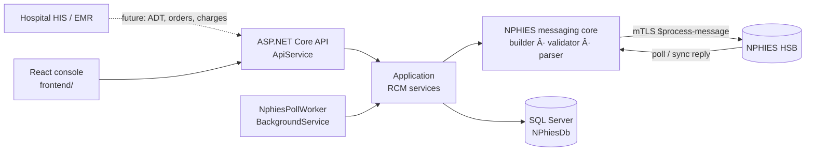
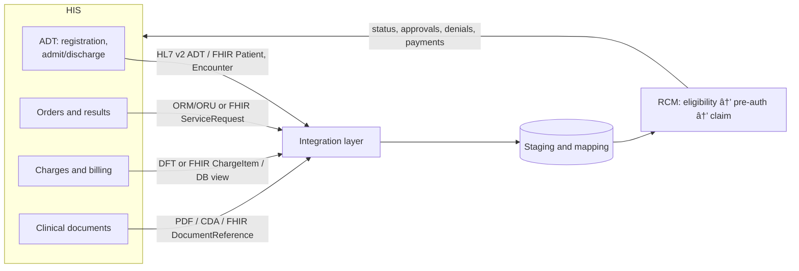

# NPHIES RCM: system overview, integration roadmap and production readiness

This document covers the whole provider-side Revenue Cycle Management (RCM) system in this repository:
- what each module does, and where its code, routes and screens are;
- what to add to integrate fully with **NPHIES** (CHI's national platform) and a hospital **HIS**;
- an honest assessment of what is still needed to run it in production.

Detailed references:
- [nphies-messaging-core.md](nphies-messaging-core.md): FHIR bundle building, transport and parsing.
- [rcm-workflows.md](rcm-workflows.md): workflow rules, statuses and configuration.
- [master-data.md](master-data.md): master tables, CRUD and the claim editor.
- [RBAC_ROLES_PERMISSIONS.md](RBAC_ROLES_PERMISSIONS.md): roles and permissions.

---

## 1. Architecture at a glance

| Layer | Project | Responsibility |
|---|---|---|
| Domain | `NPhies_FHIR_Integration.Domain` | EF entities: claims, items, coverage, patients, organizations, masters, transactions, denials, appeals, payments, audit |
| Application | `NPhies_FHIR_Integration.Application` | NPHIES messaging core (`Nphies/`) and RCM workflow services (`Rcm/`) |
| Infrastructure | `NPhies_FHIR_Integration.Infrastructure` | EF Core DbContext, migrations, repositories, seeders, mTLS/sandbox transport |
| API | `NPhies_FHIR_Integration.ApiService` | Controllers, JWT auth, RBAC, background poll worker |
| Credentials | `NPhies_FHIR_Integration.Credentials` | Certificate and secret handling for the NPHIES client certificate |
| Tests | `NPhies_FHIR_Integration.Tests` | 115 MSTest tests: builder, parser, every workflow against the docs JSON fixtures, editor |
| Frontend | `frontend/` | React + Vite + Ant Design console |

**Technology:**
- .NET 9 and EF Core on SQL Server.
- Firely `Hl7.Fhir.R4` for FHIR.
- JWT authentication with permission-based authorization.
- React Query and Ant Design on the frontend.

---

## 2. Modules

Each module is described by what it does, its backend code, its API and its screen.

### 2.1 NPHIES messaging core
Every module depends on this one.

**Backend:** `Application/Nphies/*`

**What it does:**
- **Builds bundles:** `INphiesBundleBuilder` builds every NPHIES message bundle:
  - eligibility;
  - prior auth and claim, for all 5 claim types;
  - batch, status-check, cancel/nullify, poll, communication and payment-notice.
- **Applies the NPHIES rules:** the builder sets the NPHIES profiles, extensions and code systems.
- **Validates and sends:** `INphiesMessagingClient` validates the bundle, then sends it over mTLS to `$process-message`.
- **Logs every exchange:** the request and response are written to `NphiesMessageLogs`.
- **Classifies failures:** a validation failure means nothing was sent. A timeout means the message may have been delivered, so the system never resends blindly.
- **Parses replies:** `INphiesResponseParser` turns a reply into typed results (eligibility, adjudication, task, payment reconciliation, communication request, poll contents). NPHIES error codes are enriched from the official validation-error catalogue.
- **Supports testing without NPHIES:** a sandbox transport returns the NPHIES example responses, so the system can be demonstrated end to end without live NPHIES.

### 2.2 Eligibility
**Backend:** `RcmEligibilityService`

**API:**
- `POST/GET /api/rcm/eligibility`
- `GET /api/rcm/eligibility/{id}`
- `GET /api/rcm/eligibility/patients/{id}/latest`

**Screen:** [RCM → Eligibility](http://localhost:5173/rcm/eligibility)

**What it does:**
- Sends a coverage-eligibility request: validation, benefits or discovery, for a patient, coverage and service date.
- Stores the response:
  - in-force status;
  - benefits per category (allowed, used, remaining);
  - the reason when the patient is not covered.

The latest result for each patient can be fetched before creating a claim.

### 2.3 Prior authorization (pre-auth)
**Backend:** `RcmClaimWorkflowService` (pre-auth paths)

**API:** `/api/rcm/preauths/{id}/submit | update | extend | claim | status-check | cancel`

**Screen:** [RCM → Pre-auths](http://localhost:5173/rcm/preauths)

**What it does:**
- **Claim types:** supports institutional, oral/dental, pharmacy, professional and vision. Vision includes the vision prescription.
- **Lifecycle actions:**
  - initial request;
  - **update**, which supersedes the earlier version;
  - **extend**, which references the earlier version;
  - cancel;
  - status-check.
- **Stores what the insurer granted:** the `preAuthRef` and the validity period.
- **Creates the claim:** "Create claim" turns an approved pre-auth into a claim that carries the reference.
- **Refuses expired authorizations:** linking one is rejected.

### 2.4 Claims
**Backend:** `RcmClaimWorkflowService`

**API:** `/api/rcm/claims/{id}/submit | resubmit | link-preauth | status-check | cancel | timeline | adjudication | preview-bundle`

**Screen:** [RCM → Claims](http://localhost:5173/rcm/claims)

**What it does:**
- **All 5 claim types,** with diagnoses, care team, supporting info, items and item details, encounter and episode.
- **Linking to the pre-auth:** a claim can be linked to its pre-auth.
- **Resubmission:** a corrected claim is resubmitted with `related = prior` and the earlier version is marked Superseded.
- **Cancel and nullify:** both are supported.
- **Shadow billing:** supported.
- **Review gate:** technical and medical review must approve a claim before it is sent (configurable).
- **Timeline:** every message, status change and adjudication, with the raw request and response JSON.
- **Draft preview:** the draft request bundle can be previewed before sending.

### 2.5 Claim editor
**Backend:** `RcmClaimEditorService` and `RcmClaimEditorController`

**API:** `/api/rcm/claims/{id}/edit`, `draft`, `PUT {id}`, `health`, `corrections`, `audit`, `compare`

**Screens:**
- the **New / Edit** drawer on Claims and Pre-auths;
- the Health, Audit and Compare tabs in the claim details drawer.

**What it does:**
- **Lifecycle lock:** a claim can be edited only while it is Draft, Error or ValidationFailed.
- **Calculated totals:** gross, VAT, net and the claim total are calculated by the server.
- **Health check:** finds data problems before submission.
- **Guided corrections:** for a locked claim, it offers only the actions NPHIES allows in that state.
- **Audit and compare:** a field-level audit trail with user and reason, and a version comparison against the claim it replaces.

### 2.5a Claim documents (PDF attachments)
**Backend:** `RcmDocumentService`, `ClaimDocumentStorage`, `RcmDocumentsController`

**API:**
- `/api/rcm/documents`: GET (list with filters), POST (multipart upload), `ingest` (HIS push, base64, idempotent on `externalId`), `types`, `{id}`, `{id}/content`, DELETE `{id}`, `migrate-inline` (Admin).
- `/api/rcm/claims/{id}/documents`: GET, POST `{ documentIds }`, DELETE `{documentId}`; also `document-candidates` and `size-budget`.

**What it does:**
- **One store for PDFs.** Files live outside the claim tables: metadata goes in `ClaimDocuments`, bytes go in `ClaimDocumentContents` (SQL, the default) or on disk (`Store=FileSystem`). The claim's supportingInfo only references the document (`DocumentId`), and the base64 is built when the bundle is sent.
- **Filters for long inpatient stays:** patient, encounter id or number, encounter type, invoice number, invoice date range, service date range, document type, claim, and unattached only.
- **Candidates.** For a claim, it suggests documents from the same encounter, plus unlinked documents whose service date falls inside the claim's billable period.
- **10 MB budget.** `size-budget` estimates the encoded message size. The claim health check raises `ATTACHMENT_SIZE_WARN` above `WarnMessageBytes` and blocks with `ATTACHMENTS_TOO_LARGE` above `MaxMessageBytes`. If the budget is over the limit, split the stay into interim claims or send the extra documents by Communication.
- **Compression.** When `GhostscriptPath` is set, PDFs above `CompressAboveBytes` are re-compressed. The original is kept and is available with `?original=true`.
- **Audit stays small.** The `NphiesMessageLogs` request JSON stores a `nphies-doc:{id}:{sha256}` marker instead of the base64. The JSON viewer and evidence export rehydrate it after checking the hash.
- **Migration.** `migrate-inline` moves old inline base64 attachments into the store.

**Configuration (`Rcm:Documents`):** `Store` (`Sql` or `FileSystem`), `RootPath`, `MaxUploadBytes` (25 MB), `MaxMessageBytes` (10 MB), `WarnMessageBytes` (8 MB), `BundleOverheadBytes` (64 KB), `AllowedContentTypes`, `GhostscriptPath`, `GhostscriptPreset` (`/ebook`), `CompressAboveBytes` (512 KB).

**Screens:** *Revenue cycle > Claim documents* (`/rcm/documents`) lists the store with filters for patient, encounter no./type, invoice no./date range, service date range, document type, claim id and "only unattached"; it supports upload (drag & drop, with metadata), view/download and delete (unattached only). The claim drawer has a **Documents** tab showing the 10 MB message-size bar, attached documents (detach), candidate documents of the same patient (flagged *in claim period* / *other period*) and *Upload & attach*; editing is only allowed while the claim is Draft, Error or ValidationFailed. Uploading with only a `claimId` takes patient and provider from the claim; the list date filter uses service date, falling back to invoice date and then upload date. The same Documents panel is also on the claim screens: the Claims / Pre-auth list has a **Docs** column (attachment count, red when an editable claim has none) that opens it in a modal, the row menu has *Documents / attach*, and the claim editor has a **Documents** tab (disabled while there are unsaved edits, so a save cannot drop newly attached rows).

### 2.6 Batches
**Backend:** the batch path in the claim workflow, plus `BulkOperationsController`

**API:** `POST/GET /api/rcm/batches`, `GET /api/rcm/batches/{batchId}`

**Screen:** [RCM → Batches](http://localhost:5173/rcm/batches)

**What it does:**
- Sends many claims in one batch bundle.
- Enforces the batch size limit (`Nphies:BatchMaxClaims`).
- Tracks the status of the batch and of each claim in it.

### 2.7 Poll worker and inbound ingestion
**Backend:** `NphiesPollWorker`, `RcmPollService`, `RcmResponseIngestor` and `RcmInboundService`

**API:** `POST /api/rcm/messages/poll`, `POST /api/rcm/messages/inbound`

**Screen:** none (it runs in the background)

**What it does:**
- **Polls on a schedule** (`Rcm:PollWorkerEnabled`, `PollIntervalSeconds`) for deferred messages: claim and pre-auth responses, communication requests and payment reconciliations.
- **Ingests idempotently:** a duplicate message is detected and ignored.
- **Correlates replies** to the original request by transaction, identifier, Task focus or `about`.
- **Parks unmatched replies** as `Unmatched` instead of applying them to the wrong claim.
- **Uses one ingestor for everything:** synchronous replies, polled messages and manually posted inbound bundles all go through it.

### 2.8 Communications
**Backend:** `RcmCommunicationService`

**API:**
- `/api/rcm/communication-requests`
- `/api/rcm/communication-requests/{id}/respond`
- `/api/rcm/communications`

**Screen:** [RCM → Communications](http://localhost:5173/rcm/communications)

**What it does:**
- **Insurer requests:** shows the insurer's requests for more information.
- **Solicited replies:** answers a request with text and attachments.
- **Unsolicited communications:** sends a communication the insurer didn't ask for, about a claim or pre-auth.

### 2.9 Payment reconciliation
**Backend:** `RcmPaymentService`

**API:** `/api/rcm/payments`, `discrepancies`, `{id}/acknowledge`, `details/{detailId}/match`

**Screen:** [RCM → Payments](http://localhost:5173/rcm/payments)

**What it does:**
- **Stores** each payment reconciliation and its details.
- **Matches** each detail to a claim. The expected amount is approved + VAT, and the paid amount is the payment component.
- **Classifies** each detail as Matched, Underpaid, Overpaid or Unmatched.
- **Reports discrepancies.**
- **Acknowledges** the reconciliation with a payment-notice, automatically or manually.
- **Shows the money on the claim list:** Expected, Paid and Variance columns.

### 2.10 Denials and appeals
**Backend:** `RcmDenialAppealService`

**API:**
- `/api/rcm/denials`, `summary`, `PATCH {id}`
- `/api/rcm/appeals`, `{id}/withdraw`

**Screen:** [RCM → Denials](http://localhost:5173/rcm/denials)

**What it does:**
- **Creates a denial record** from real adjudication data, one per rejected or reduced item, using the payer's reason code.
- **Categorises** denials as Contractual, Technical, Duplicate and so on.
- **Sets an appeal deadline** (`Rcm:AppealWindowDays`).
- **Appeals a claim:** clones it with `related = prior`, resubmits it, optionally sends a communication with attachments, and resolves the appeal when the new version is adjudicated.
- **Appeals a pre-auth:** sends a pre-auth update.

### 2.11 Dashboard and reports
**Backend:** `RcmAnalyticsService`

**API:** `/api/rcm/reports/dashboard | aging | denial-rate | payers`

**Screen:** [Dashboard](http://localhost:5173/)

**What it shows:**
- KPIs: claimed, approved, paid, outstanding, denial rate and clean-claim rate;
- accounts-receivable aging buckets;
- denial rate by month, week, payer or reason;
- a breakdown by payer.

All of it can be filtered by date range and hospital.

### 2.12 Master data
**Backend:** `MastersController` and the master-data controllers

**API:** `api/masters/*`

**Screen:** [Master data](http://localhost:5173/master-data)

**What it does:**
- **CRUD for every master that feeds the claim JSON:**
  - organizations (providers, payers);
  - payer policies;
  - practitioners and doctors, clinics and locations;
  - patients and coverages;
  - code masters (services, drugs, diagnoses, CodeableConcepts).
- **Validation:** checks required fields, lengths, coded values, foreign keys and uniqueness.
- **Safe delete:** deactivates a row instead of deleting it when the row is still referenced.
- **Hospital scoping:** each user sees only their hospital's rows.

### 2.13 Data explorer
**Backend:** `DataExplorerController`

**API:** `api/data/{table}`

**Screen:** [Data explorer](http://localhost:5173/data)

**What it does:**
- Opens a grid for any table: claim headers, details, responses, transactions and logs.
- Filters by hospital and date.
- Pages, sorts and exports to CSV.

### 2.14 Security, users and audit
**Backend:** `AuthController`, `UsersController`, `RolesController`, `AccessControlController` and `AuditController`

**Screen:** [Users / Roles / Permissions](http://localhost:5173/users)

**What it does:**
- **Login:** JWT with refresh tokens; an MFA flag is supported.
- **Permissions:** granular, e.g. `claims:submit` and `masterdata:manage`.
- **Hospital scoping:** a user's organization limits what they see.
- **Audit trail:** recorded for edits and for NPHIES message logs.

### 2.15 Sample data and sandbox
**Backend:** the seeders in Infrastructure

**What it does:**
- **Development seed data:** masters, payers, payer policies, patients, coverages, claims of every type, pre-auths, responses, payments and denials.
- **Sandbox transport:** combined with the seed data, the whole cycle can be demonstrated without NPHIES access.

---

## 3. What to add for full NPHIES integration

The core message set is implemented. To pass NPHIES onboarding and certification and to run live, add the following.

| # | Item | Why |
|---|---|---|
| N1 | **Onboarding and the certification test cases.** Run every NPHIES test-case script (`nphies-fhir-docs-main` test-case PDFs) against the **NPHIES pre-production** environment and store the evidence. | CHI requires the test cases to pass before production credentials are issued. |
| N2 | **Production certificate and license setup.** Configure the real provider license, the NPHIES IDs of the facility, the payers and the TPAs, and a client certificate held in a secure store (Key Vault or HSM). Add certificate expiry alerts. | Today the certificate is loaded from configuration or the Credentials project. |
| N3 | **Code-set synchronisation.** Scheduled import of the NPHIES CodeSystems and ValueSets (SBS, SFDA drugs, ICD-10-AM, ACHI, benefit categories, denial reasons), with versioning. | Codes change; validating against stale codes causes rejections. |
| N4 | **Payer-specific rules.** Store each payer's rules (benefits that need pre-auth, attachment requirements, price lists and contracts) and check claims against them before submission. | Reduces avoidable denials, which is the biggest revenue win. |
| N5 | **Full-profile validation.** Validate the bundle locally against the IG's StructureDefinitions (Firely validator with the NPHIES package) in addition to the current rules. | Catches profile errors before NPHIES does. |
| N6 | **Remaining use cases.** Add advanced authorization (insurer-initiated), the coverage-eligibility "discovery" variants per payer, recoupment/refund handling in payment reconciliation, and the newest IG messages (check the IG changelog). | Completes coverage of the IG. |
| N7 | **Real attachments.** Store large PDFs and images in blob storage. Enforce the NPHIES size and MIME limits. Keep only references in SQL. | Attachments are base64 in the database today, which won't scale. |
| N8 | **Poll and timeout hardening.** Back off when NPHIES is down. Send an automatic status-check after a timeout. Alert when a poll queue gets stuck. Run the poll worker as a single instance (distributed lock) when there are several API nodes. | Supports reliable unattended operation. |
| N9 | **Electronic remittance to finance.** Post reconciled payments to the hospital's general ledger and AR. | Closes the cash loop. |

---

## 4. What to add for HIS integration

Today data is entered through the master and claim screens, or comes from seeding. In a hospital, the HIS is the source of truth for patients, encounters, orders and charges, so the RCM system should **receive** that data, not ask users to retype it.

| # | Item | Details |
|---|---|---|
| H1 | **Integration approach** | Pick one per hospital: an **HL7 v2** listener (MLLP) for ADT, ORM and DFT, a **FHIR R4** API, or a **database view or ETL** for older HIS systems. Put an integration engine (Mirth/NextGen Connect, or a .NET listener) in front of the API. |
| H2 | **Patient and coverage sync** | ADT A04/A08 to Patient (national ID or iqama, Arabic name) and Coverage. Merge and de-duplicate patients (MPI). |
| H3 | **Encounter sync** | Admission and discharge (A01/A03) to Encounter, which drives the institutional claim periods and the episode. |
| H4 | **Charge capture** | HIS charges to claim items, through a **mapping table** from HIS service codes to NPHIES (SBS) codes and price lists. Group charges into claims by encounter and payer. |
| H5 | **Clinical data for claims** | Diagnoses (ICD-10-AM), vital signs, chief complaint, lab results and vision prescriptions, pulled from HIS to fill supporting info automatically. |
| H6 | **Eligibility at registration** | When HIS registers a patient, call eligibility automatically and send the result back to the HIS screen. |
| H7 | **Pre-auth from orders** | When an order needs authorization under the payer's rules, create the pre-auth automatically and return the approval to HIS before the service is given. |
| H8 | **Write-back** | Push claim status, approved amounts, patient share, denials and payments back to HIS billing and finance (HL7 DFT, FHIR or API callback). |
| H9 | **Master data sync** | Doctors, clinics, departments and price lists come from HIS or ERP instead of manual entry. |
| H10 | **Work queues** | Coder and biller queues: "claims ready to submit", "needs coding", "denied – action required", "communication requested". These show HIS-sourced claims awaiting human review. |

---

## 5. Making it production grade

### 5.1 Current maturity (honest assessment)

| Area | Status | Notes |
|---|---|---|
| NPHIES message coverage | 🟢 Good | All main use cases are built and tested against the official examples. Not yet run against NPHIES pre-production. |
| Workflow logic | 🟢 Good | Statuses, idempotent ingestion, correlation, payments, denials, appeals. |
| UI | 🟡 Functional | Every module has a screen. Arabic/RTL, accessibility and UX polish are still needed. |
| Integration with HIS | 🔴 Missing | No inbound interfaces yet. |
| Security | 🟡 Partial | JWT, RBAC and hospital scoping work. Secrets management, MFA enforcement, rate limiting, PDPL compliance and a penetration test are not done. |
| Reliability | 🟡 Partial | No outbox or queue, no distributed lock for the poller, no retry policy. |
| Observability | 🔴 Minimal | Logs only. No metrics, tracing or alerts. |
| Performance | 🟡 Unknown | No load test yet. One query timeout has already been fixed with split queries; more indexes and paging review are likely needed. |
| DevOps | 🔴 Missing | No CI/CD pipeline, environments or automated migrations strategy. Build output (`Credentials/bin`, `obj`) is tracked in git. |
| Tests | 🟡 Partial | 115 backend tests pass. There are no frontend tests, no E2E tests and no load tests. |

My overall estimate: **about 60–65 % ready for production.** The NPHIES functionality is the strongest part. Operations, security hardening and the HIS interfaces are the main gaps.

### 5.2 Hardening checklist

**Security and compliance**
- Store secrets (JWT key, database, certificate password) in Key Vault or a similar store. Rotate keys and certificates.
- Enforce MFA for admins and approvers. Add account lockout and a password policy.
- Comply with the **Saudi PDPL** (Personal Data Protection Law) and the NCA ECC controls:
  - encrypt data at rest (TDE) and in transit;
  - mask national IDs and iqamas in logs;
  - keep data in the KSA region;
  - define a retention policy for message logs and attachments.
- Rate limiting, CORS lock-down, security headers, and dependency/vulnerability scanning.
- An external penetration test before go-live.

**Reliability**
- An **outbox pattern** for NPHIES sends, so a crash between the DB write and the send can neither lose a message nor send it twice.
- Polly retry and circuit-breaker policies for the transport (never retrying non-idempotent sends blindly).
- A distributed lock or leader election for the poll worker. Health checks for the database, certificate validity and NPHIES reachability.
- Database backups and restore drills. High availability (two or more API nodes behind a load balancer).

**Observability**
- Structured logging (Serilog) with correlation IDs from the UI through the API to NPHIES.
- OpenTelemetry metrics and traces covering:
  - messages sent and failed per type and payer;
  - NPHIES latency;
  - poll lag;
  - unmatched-message count;
  - denial rate.
- Alerts for repeated NPHIES errors, certificate expiry, a stuck poll, unmatched payments and growth in the timeout queue.
- An operations dashboard (Grafana or Azure Monitor).

**Data and performance**
- Index review for the claim list, the reports and the data explorer (status, dates, provider and payer columns).
- Archive or partition `NphiesMessageLogs` and transactions (they grow fastest).
- A load test, for example 10k claims a day and batches of the maximum size.
- Turn off the development seeders in production; make migrations a deployment step, not something done at startup.

**Product and UX**
- An Arabic UI and RTL layout, with bilingual patient names everywhere.
- Coder and biller work queues, bulk actions, and saved filters.
- Printable claim and remittance reports (PDF) and scheduled e-mailed reports.
- A rejection-reason knowledge base: for each NPHIES error or denial code, show how to fix it inside the editor.

**Engineering**
- A CI pipeline: build, the 115+ tests, frontend lint/tsc/build and migration checks on every PR.
- Remove build output from git and fix the 108 compiler warnings and the `tsc -b` config error.
- Retire the duplicated legacy controllers (`ClaimsController`, `RCMController` and `PreAuthorizationController`) once the UI uses only `/api/rcm/*`.
- Frontend unit tests and Playwright E2E tests for the main flows.

### 5.3 Suggested roadmap and effort

Rough estimates for **one experienced full-stack developer**. With two or three developers working in parallel, the calendar time drops by about half.

| Phase | Scope | Effort |
|---|---|---|
| **1. NPHIES certification** | N1, N2, N5 and fixes from the test-case runs | 3–4 weeks |
| **2. Production foundations** | Secrets, outbox, retries, poller lock, logging and metrics, CI/CD, index review, seeders off | 3–4 weeks |
| **3. HIS integration, core** | H1–H4 and H8 (patient, encounter, charges and write-back) for one HIS | 5–8 weeks (depends on the HIS) |
| **4. Revenue protection** | N3, N4 and H6/H7 (code sync, payer rules, automatic eligibility and pre-auth) | 4–6 weeks |
| **5. Scale and polish** | N7–N9, H5, H9, H10, Arabic/RTL, work queues, E2E and load tests, penetration test | 4–6 weeks |

**Total: about 4–6 months** for a production-grade system integrated with one HIS. A **pilot go-live** with manual or semi-manual claim entry (no HIS feed) is realistic after **phases 1 and 2, about 6–8 weeks**.

---

## 6. Running locally (quick reference)

- API: `https://localhost:7590`. Frontend: `http://localhost:5173`. Login: `admin` / `Admin@12345!` (development only).
- The poll worker is off by default (`Rcm:PollWorkerEnabled`). The sandbox transport and the seed data are for development only.
- Tests: `dotnet test NPhies_FHIR_Integration.Tests`. Frontend: `cd frontend; npx tsc -p tsconfig.json --noEmit; npm run build`.

---

## 7. Work breakdown: incomplete parts

The remaining work is split into **8 workstreams** and **36 work packages**. Each package is small enough to assign to one person and can be delivered and tested on its own.

**Columns:**
- **Effort:** person-days for one experienced developer.
- **Depends on:** the work packages that must finish first.

**Skill codes:**
- **BE:** .NET backend
- **FE:** React frontend
- **INT:** integration (HL7/FHIR)
- **OPS:** DevOps
- **QA:** testing
- **BA:** business analyst or RCM domain expert

### WS1: NPHIES certification and go-live (critical path)

| ID | Work package | What exactly is incomplete | Skill | Effort | Depends on |
|---|---|---|---|---|---|
| WS1.1 | Pre-production connectivity | Connect to the real NPHIES pre-production endpoint with the real client certificate. Confirm the mTLS handshake, `$process-message` and poll. **Tooling done:** `GET api/rcm/conformance/connectivity` checks configuration, the client certificate (expiry, private key), DNS and the TLS handshake; `POST api/rcm/conformance/connectivity/poll` adds a real poll-request round trip. Remaining: run it against pre-production with the real certificate. | BE, OPS | 3 | — |
| WS1.2 | Facility and payer identifiers | Load the real provider license, NPHIES facility IDs, the payer and TPA list and the payer endpoints into the masters. Remove the sample IDs. | BA, BE | 2 | — |
| WS1.3 | Test-case execution | Run every NPHIES test-case script (eligibility, pre-auth ×5 types, claim ×5 types, batch, cancel, status-check, communication, payment, poll). Record the request, response and screenshot evidence. Evidence packs (zip of every exchanged bundle, timeline and summary) come from `GET api/rcm/claims/{id}/evidence` or `POST api/rcm/conformance/evidence`; message audit must stay enabled. | QA, BE | 8 | WS1.1, WS1.2 |
| WS1.4 | Defect fixing from test cases | **Early pass done.** Generated bundles conform to the current IG (Task profiles, insurer/provider types, occupation, marital status, passport country, timing, onset, encounter). New claim-editor health rules block non-conformant claims, and a strict test checks that every seeded claim has zero profile errors. Remaining: fix the errors NPHIES reports from the live test cases (WS1.3); see `nphies-messaging-core.md`. | BE | 5 | WS1.3 |
| WS1.5 | Local IG profile validation | **Done.** The NPHIES IG package is embedded and an in-house profile validator (cardinality, slicing, fixed/pattern, required bindings, extensions, NPHIES invariants) runs on every send (`Nphies:ProfileValidation:Mode` = Off/Warn/Enforce, default Warn). Findings appear in the bundle preview, the claim Health tab and `POST api/rcm/conformance/validate`. Remaining: the IG gaps it reports are listed in `nphies-messaging-core.md` (feeds WS1.4). | BE | 4 | — |
| WS1.6 | Missing use cases | **Mostly done.** Advanced authorizations (insurer-initiated ClaimResponses delivered by poll) are stored and can be quoted on a claim (`api/rcm/advanced-authorizations`). Payment reconciliation handles adjustment/recoupment lines: matched through `predecessor`, claim paid amount is netted and the claim becomes `Recouped` (resubmit/appeal allowed). Remaining: check the latest IG changelog for any new messages. | BE | 5 | WS1.1 |
| WS1.7 | Production credentials | Request the production certificate and license from CHI, set up configuration per environment, and sign off cut-over. | OPS, BA | 2 | WS1.4 |

### WS2: Production foundations (reliability and security)

| ID | Work package | What exactly is incomplete | Skill | Effort | Depends on |
|---|---|---|---|---|---|
| WS2.1 | Secrets management | Move the JWT key, database connection string and certificate password to Key Vault or a similar store. Add rotation and certificate expiry alerts. | OPS, BE | 3 | — |
| WS2.2 | Outbox for NPHIES sends | Make sends crash-safe. The send request is saved to an outbox table, and a worker sends it. There must be no lost or double sends. | BE | 5 | — |
| WS2.3 | Retry and circuit breaker | Polly policies on the transport: retry only messages that are safe to repeat, and after a timeout run a status-check automatically. | BE | 3 | WS2.2 |
| WS2.4 | Poll worker on several servers | Use a distributed lock so only one server polls at a time. Add backoff while NPHIES is down and an alert when polling stalls. | BE | 2 | — |
| WS2.5 | Authentication hardening | Enforce MFA for admins and approvers. Add account lockout, a password policy and rate limiting. Lock down CORS and security headers. | BE | 4 | — |
| WS2.6 | Saudi PDPL compliance | Encrypt data at rest (TDE). Mask national IDs and iqamas in logs. Add a retention and archive policy for message logs and attachments. Keep data in KSA hosting. | BE, OPS | 4 | — |
| WS2.7 | Penetration test and fixes | External penetration test, then remediation. | OPS, BE | 5 | WS2.1–WS2.6 |

### WS3: DevOps and code hygiene

| ID | Work package | What exactly is incomplete | Skill | Effort | Depends on |
|---|---|---|---|---|---|
| WS3.1 | CI pipeline | On every PR: build, backend tests, frontend lint/tsc/build and a migration check. | OPS | 3 | — |
| WS3.2 | CD and environments | Dev, test (pre-production NPHIES) and production. Migrations run as a deployment step, not at startup. Development seeders and the sandbox transport are switched off outside dev. | OPS, BE | 4 | WS3.1 |
| WS3.3 | Repository cleanup | Remove `bin/` and `obj/` (Credentials) from git. Fix the 108 compiler warnings and the `tsc -b` config error. | BE, FE | 2 | — |
| WS3.4 | Retire legacy endpoints | Move the remaining screens to `/api/rcm/*`, then delete the duplicated `ClaimsController`, `RCMController`, `PreAuthorizationController` and the old Claims page. | BE, FE | 4 | — |
| WS3.5 | High availability and backup | Two or more API servers behind a load balancer, plus database backups with a restore drill. | OPS | 3 | WS3.2 |

### WS4: Observability

| ID | Work package | What exactly is incomplete | Skill | Effort | Depends on |
|---|---|---|---|---|---|
| WS4.1 | Structured logging | Serilog with one correlation ID that follows a request from the UI through the API to NPHIES and back. | BE | 2 | — |
| WS4.2 | Metrics and tracing | OpenTelemetry: messages per type and payer, errors, NPHIES latency, poll lag, unmatched messages, timeouts. | BE, OPS | 3 | WS4.1 |
| WS4.3 | Alerts and operations dashboard | Grafana or Azure Monitor dashboards. Alerts for NPHIES errors, certificate expiry, a stuck poll, unmatched payments and timeout growth. | OPS | 3 | WS4.2 |

### WS5: HIS integration (needs the HIS vendor and interface specs)

| ID | Work package | What exactly is incomplete | Skill | Effort | Depends on |
|---|---|---|---|---|---|
| WS5.1 | Interface analysis | Agree the integration method with the HIS vendor (HL7 v2 over MLLP, FHIR or a database view), the message samples and the field mapping. | BA, INT | 5 | — |
| WS5.2 | Integration listener and staging | An inbound listener (Mirth or a .NET MLLP or FHIR endpoint), staging tables, an error queue and replay. | INT, BE | 6 | WS5.1 |
| WS5.3 | Patient and coverage sync | ADT A04/A08 to Patient and Coverage. Store the Arabic name, the identifier type (national ID, iqama or passport) and handle patient merges. | INT, BE | 5 | WS5.2 |
| WS5.4 | Encounter sync | ADT A01/A03 to Encounter (admission and discharge, department, attending doctor), which drives institutional claims and episodes. | INT, BE | 4 | WS5.2 |
| WS5.5 | Charge capture to draft claims | HIS charges to claim items, grouped by encounter and payer, then a draft claim is created automatically. | INT, BE | 8 | WS5.4, WS6.1 |
| WS5.6 | Clinical data to supporting info | Diagnoses, vital signs, chief complaint, lab results and vision prescriptions from the HIS fill the supporting info automatically. | INT, BE | 5 | WS5.4 |
| WS5.7 | Write-back to HIS | Send claim status, approved amount, patient share, denials and payments back to HIS billing (DFT, FHIR or callback). | INT, BE | 5 | WS5.2 |
| WS5.8 | Master sync | Doctors, clinics, departments and price lists from the HIS or ERP instead of manual entry. | INT, BE | 4 | WS5.2 |

### WS6: Revenue protection (fewer denials)

| ID | Work package | What exactly is incomplete | Skill | Effort | Depends on |
|---|---|---|---|---|---|
| WS6.1 | Code mapping | A table mapping HIS service, drug and diagnosis codes to NPHIES (SBS, SFDA, ICD-10-AM, ACHI) codes, with a UI to maintain it and a report of unmapped codes. | BE, FE, BA | 5 | — |
| WS6.2 | Code-set synchronisation | Scheduled, versioned import of the NPHIES CodeSystems and ValueSets. Flag codes that are no longer active on draft claims. | BE | 4 | — |
| WS6.3 | Payer contracts and price lists | Each payer's prices, discounts and coverage rules. Check unit prices against the contract before submission. | BE, FE, BA | 6 | — |
| WS6.4 | Pre-submission rules engine | Configurable per-payer rules: needs pre-auth, needs an attachment, frequency or age/gender limits, duplicate check. Results appear in the Health tab. | BE, FE | 8 | WS6.3 |
| WS6.5 | Automatic eligibility and pre-auth | Run eligibility automatically at registration, and create a pre-auth automatically from orders that need one. | BE | 5 | WS5.3, WS6.4 |
| WS6.6 | Denial knowledge base | For each NPHIES error or denial code, a recommended fix shown in the editor and on the Denials page. | BA, FE | 3 | — |

### WS7: Product and UX completion

| ID | Work package | What exactly is incomplete | Skill | Effort | Depends on |
|---|---|---|---|---|---|
| WS7.1 | Arabic and RTL | i18n for every screen, RTL layout and bilingual patient names. | FE | 6 | — |
| WS7.2 | Work queues | Coder and biller queues: ready to submit, needs coding, denied, communication requested, payment variance. Assign to users and set SLA timers. | BE, FE | 6 | — |
| WS7.3 | Attachments in blob storage | Store files in blob storage instead of base64 in SQL. Enforce the NPHIES size and MIME limits. Add a viewer. | BE, FE | 4 | — |
| WS7.4 | Finance posting and remittance | Post reconciled payments and adjustments to the ERP or general ledger, and print a PDF remittance advice. | BE, INT | 5 | — |
| WS7.5 | Reports pack | Printable PDF and Excel reports, scheduled e-mailed reports, and a CHI and management KPI pack. | BE, FE | 5 | — |

### WS8: Quality and performance

| ID | Work package | What exactly is incomplete | Skill | Effort | Depends on |
|---|---|---|---|---|---|
| WS8.1 | Frontend tests | Vitest unit tests for forms, calculations and API hooks. | FE, QA | 4 | — |
| WS8.2 | E2E tests | Playwright tests for login ? eligibility ? pre-auth ? claim ? payment ? denial/appeal against the sandbox. | QA | 5 | WS3.1 |
| WS8.3 | Indexes and query review | Indexes for the claim list, reports and data explorer, split queries elsewhere, and partition or archive `NphiesMessageLogs`. | BE | 3 | — |
| WS8.4 | Load test | 10k claims a day, maximum-size batches, and polling with large queues. Tune until the targets are met. | QA, BE | 4 | WS8.3 |

### Suggested team split

| Person | Workstreams | Approx. days |
|---|---|---|
| Backend dev 1 (NPHIES) | WS1, WS6.2, WS6.4 | ~45 |
| Backend dev 2 (platform) | WS2, WS4, WS8.3–WS8.4 | ~45 |
| Integration dev | WS5, WS7.4 | ~50 |
| Frontend dev | WS3.4 (UI), WS6.1/6.3 UI, WS7.1–WS7.3, WS7.5, WS8.1 | ~40 |
| DevOps | WS3, WS2.1, WS4.3 | ~20 |
| QA + BA | WS1.3, WS5.1, WS6.6, WS8.2 and acceptance testing | ongoing |

**Milestones:**
- **M1 Pilot go-live** (manual claim entry): WS1, WS2.1–WS2.5, WS3.1–WS3.3 and WS4.1. About 6–8 weeks.
- **M2 HIS-integrated:** M1 + WS5 + WS6.1. About 3 months.
- **M3 Production grade:** everything above. About 4–6 months with one developer per role.
