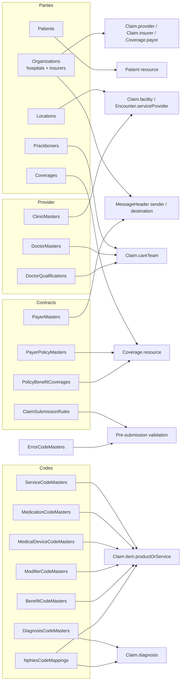

# Master data: what feeds the NPHIES request JSON

Every eligibility, prior-authorization and claim bundle is built by `RcmInputMapper` from the claim itself
(items, diagnoses, care team, supporting info, encounter) plus the master tables below. The **Master Data**
page (`/master-data`) maintains all of them through one metadata-driven API (`api/masters`).

| Group | Master (table) | Feeds in the request JSON |
|---|---|---|
| Parties | Organizations | `MessageHeader.sender/destination`, `Claim.provider`, `Claim.insurer`, `Coverage.payor` |
| Parties | Locations | `Claim.facility`, `Encounter.serviceProvider`, `item.locationCodeableConcept` |
| Parties | Practitioners | `Claim.careTeam.provider`, `careTeam.qualification` |
| Parties | Patients | `Claim.patient`, `CoverageEligibilityRequest.patient` (identifier NI/PRC/PPN, name en/ar, gender, birthDate) |
| Parties | Coverages | `Claim.insurance.coverage` (memberId, policy, class, relationship) |
| Codes | ServiceCodeMasters | `Claim.item.productOrService` (services, procedures, lab, imaging), default unit price |
| Codes | MedicationCodeMasters | `Claim.item.productOrService` for pharmacy claims |
| Codes | MedicalDeviceCodeMasters | `Claim.item.productOrService` (medical devices) |
| Codes | DiagnosisCodeMasters | `Claim.diagnosis.diagnosisCodeableConcept` |
| Codes | ModifierCodeMasters | `Claim.item.modifier` |
| Codes | BenefitCodeMasters | `CoverageEligibilityRequest.item.category` |
| Codes | NphiesCodeMappings | local code → NPHIES code-system translation |
| Contracts | PayerMasters | insurer license for `Claim.insurer` / `MessageHeader.destination`, submission limits |
| Contracts | PayerPolicyMasters | `Coverage.class` (plan), patient share, prior-auth thresholds |
| Contracts | PolicyBenefitCoverages | whether pre-auth is required, expected adjudication % |
| Contracts | ClaimSubmissionRules | pre-submission checks (max amount, item count, required attachments) |
| Provider | ClinicMasters | `Encounter.serviceType`, claim department |
| Provider | DoctorMasters | care-team defaults (specialty, qualification) |
| Provider | DoctorQualifications | `Claim.careTeam.qualification` |
| Reference | ErrorCodeMasters | explanations for NPHIES validation errors |

The catalog itself (labels, purposes, coded options, natural keys, permissions) lives in
`NPhies_FHIR_Integration.ApiService/MasterData/MasterCatalog.cs`.

## API

| Method | Route | Notes |
|---|---|---|
| GET | `api/masters/catalog?hospitalId=&counts=true` | Masters the user can read, with fields, what they feed, and row counts |
| GET | `api/masters/{table}/meta` | Field metadata: type, required, max length, options, lookup table |
| GET | `api/masters/{table}/{id}` | One row and its child counts |
| POST | `api/masters/{table}` | Create; returns `400 { message, errors: { field: text } }` on validation failure |
| PUT | `api/masters/{table}/{id}` | Update (partial values allowed) |
| DELETE | `api/masters/{table}/{id}` | Deletes the row, or deactivates it when claims or other rows still reference it |
| GET | `api/masters/lookup/{table}?search=&hospitalId=&take=&f.column=value` | Pick list for foreign-key selects |
| GET | `api/data/{table}` | Grid listing with hospital and date filters, paging, sorting and CSV export |

Validation covers required fields, maximum length, coded values, foreign-key existence and unique or natural keys.
Users bound to a hospital can only see and change that hospital's rows. Hospital-scoped tables are those with
`OrganizationId` or `ProviderId`. Those users cannot create organizations. Patients and Coverages use the
`patients:*` permissions; every other master uses `masterdata:manage`.

## Claim editor

Open it from **RCM ? Claims** with **New claim / pre-auth**, the row menu (**Edit** or **View in editor**), or the **Edit** button in the claim details drawer.

- **Lock rules.** You can edit a claim only while its status is Draft, Error or ValidationFailed. Otherwise the editor is read-only and shows the reason. The legacy `PUT api/claims/{id}` returns `409` for locked claims.
- **Totals are recalculated by the server.** For each item, gross = quantity × unit price × factor, VAT = gross × rate, and net = gross + VAT. The header total is the sum of the item nets. Users never type these values.
- **Health check.** This checks the header, items, diagnoses, care team and supporting info, for example: pre-auth link, coverage period, item net math, tooth/surface on oral claims and lenses on vision claims.
- **Corrections.** The row menu has **Correct… (guided options)**. A locked claim offers lifecycle actions instead of edits: status-check, cancel, nullify, resubmit, update, extend, create claim from the pre-auth, communicate, or appeal. Derived claims are created as drafts and open in the editor.
- **Audit and compare.** Every create or edit writes a field-level diff with the user and the reason. The drawer's **Audit** tab lists these diffs. The **Compare** tab compares a claim with the claim it replaces (`related`).
- **Money.** Approved amount excludes VAT. Expected payment = approved + approved VAT. Variance = expected - paid; a positive variance means underpaid.

| Method | Route | Notes |
|---|---|---|
| GET | `api/rcm/claims/{id}/edit` | Editable view including `locked` and `lockedReason` |
| POST | `api/rcm/claims/draft` | Create a draft claim or pre-auth |
| PUT | `api/rcm/claims/{id}` | Save a draft; returns `409` when locked |
| GET | `api/rcm/claims/{id}/health` | Health issues for one claim |
| GET | `api/rcm/claims/health?problemsOnly=true` | Health report for many claims |
| GET | `api/rcm/claims/{id}/corrections` | Correction options allowed in the current state |
| GET | `api/rcm/claims/{id}/audit` | Change history |
| GET | `api/rcm/claims/{id}/compare` | Version compare with the related claim |
